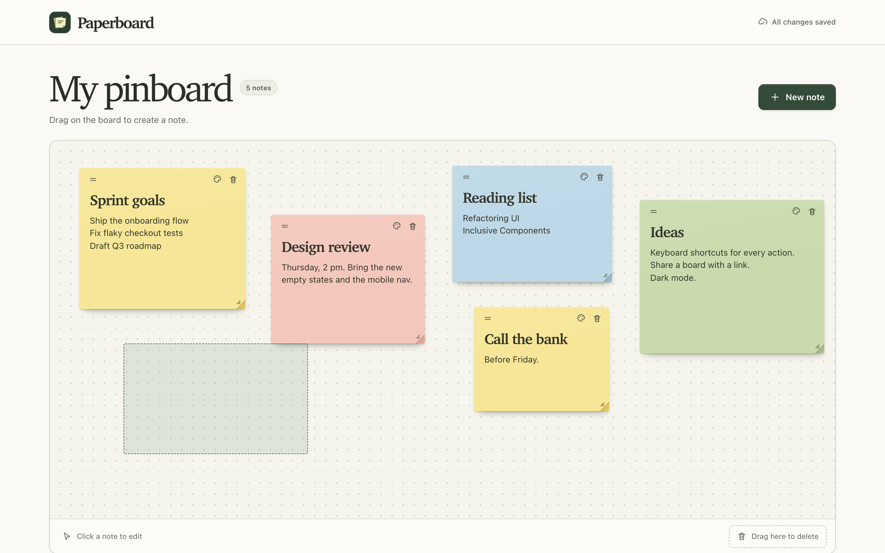
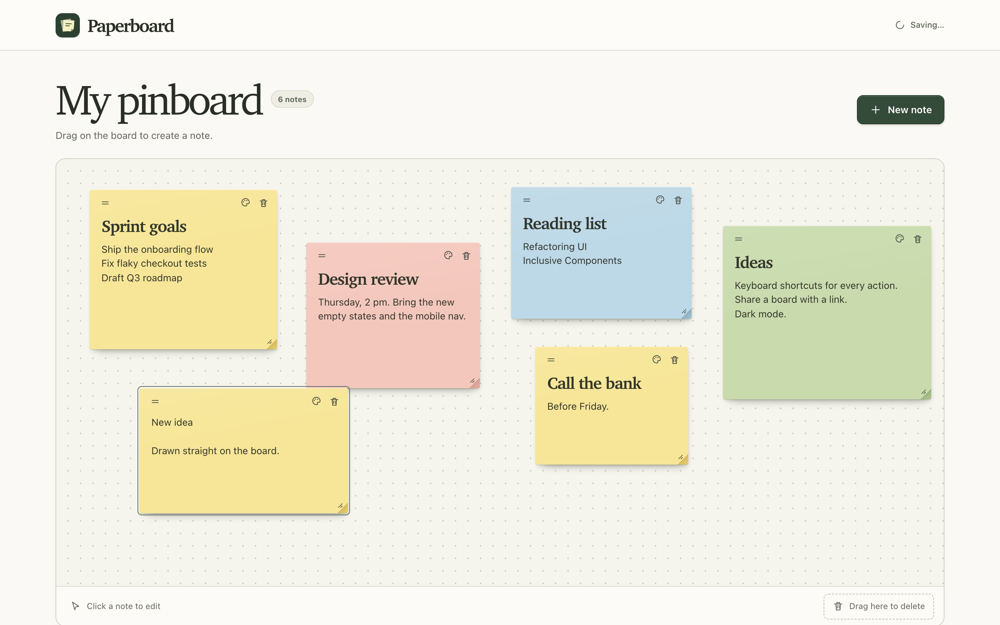
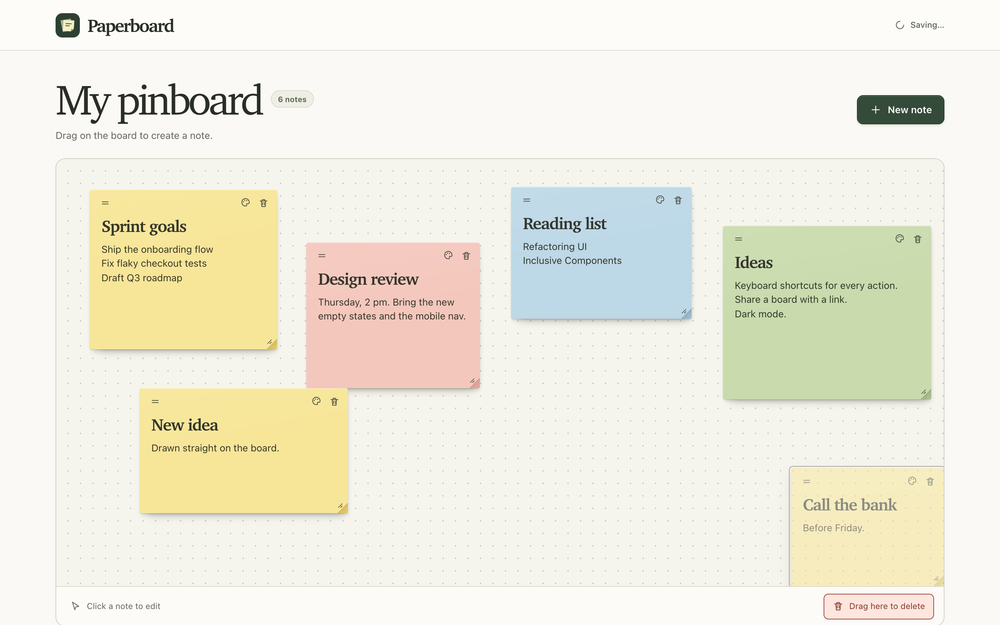
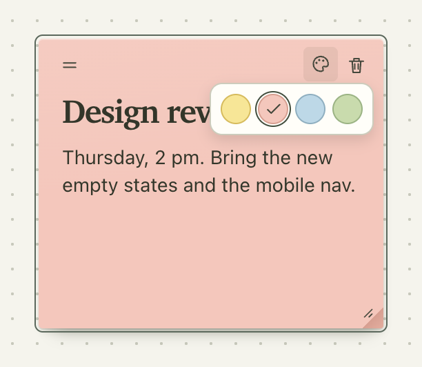

# Paperboard

**A sticky-notes board for the desktop, built with React and TypeScript.**

Draw notes straight onto the board, then move, resize, recolor and edit them, or drag them to the trash. Every interaction is implemented from scratch on Pointer Events. The project uses no UI kit and no drag-and-drop library.


## Contents

- [Features](#features)
- [Screenshots](#screenshots)
- [Getting started](#getting-started)
- [Project structure](#project-structure)
- [Architecture](#architecture)
- [Assumptions and trade-offs](#assumptions-and-trade-offs)

## Features

All four required features and all five optional ones are implemented.

| | Feature | How to use it |
| --- | --- | --- |
| ✅ | **Create** a note of a given size at a given position | Drag across empty board space, in any direction. **New note** adds a standard 240 × 190 note. |
| ✅ | **Resize** by dragging | Drag the bottom-right corner. |
| ✅ | **Move** by dragging | Drag the grip at the top of the note. |
| ✅ | **Delete** by dropping on the trash zone | Drag the grip and release over **Drag here to delete**. The note fades and the zone turns red while the pointer is over it. Each note also has a trash button. |
| ⭐ | **Edit text** | Click the text and type. The first line becomes the title. Click outside or press Escape to finish. |
| ⭐ | **Bring to front** | Any interaction with a note raises it above overlapping notes. |
| ⭐ | **Local storage** | The board is restored on page load. |
| ⭐ | **Colors** | Pick one of four colors from the palette in the note toolbar. |
| ⭐ | **REST API** | Every change is sent to an asynchronous mock endpoint, `PUT /api/boards/:id`. |

The board also works from the keyboard. Tab moves between controls. On a focused move or resize handle, the arrow keys adjust the note in 10 px steps. Escape cancels a drag in progress, and the note snaps back to where it was.

## Screenshots

| Draw a note anywhere | Type straight into it |
| --- | --- |
|  |  |
| **Drop it on the trash to delete** | **Pick a color** |
|  |  |

## Getting started

**Requirements:** Node.js 22.12 or newer, and [pnpm](https://pnpm.io/installation) (run `corepack enable` to get it).

```sh
pnpm install --frozen-lockfile
pnpm dev
```

Then open [http://localhost:3000](http://localhost:3000).

To build and serve the production version:

```sh
pnpm build
pnpm start
```

### Scripts

| Command | What it does |
| --- | --- |
| `pnpm dev` | Starts the development server |
| `pnpm build` / `pnpm start` | Builds and serves the production version |
| `pnpm typecheck` | Runs TypeScript in strict mode |
| `pnpm lint` | Runs ESLint with the Next.js and TypeScript rules |
| `pnpm test` | Runs the Vitest unit tests (gesture geometry and data validation) |

**Supported browsers:** current Chrome (Windows and macOS), Firefox and Edge, at 1024 × 768 or larger.

## Project structure

```
src/
├── app/
│   ├── page.tsx, layout.tsx       The single page
│   ├── globals.css                All styles (Tailwind + plain CSS)
│   └── api/boards/[id]/route.ts   Mock REST endpoint (GET / PUT)
├── components/
│   ├── StickyBoard.tsx            Board state, pointer gestures, trash zone
│   ├── NoteCard.tsx               One note: toolbar, color picker, text editor, handles
│   └── Icon.tsx                   Inline SVG icons
└── lib/
    ├── notes.ts                   Note type, constants, runtime validation
    ├── geometry.ts                Pure gesture math (draw, move, resize, clamping)
    └── useNotes.ts                Persistence: localStorage + debounced REST sync
```

## Architecture

The page renders one client component, `StickyBoard`, which owns the notes and all transient interaction state. Draw, move and resize go through a single gesture pipeline. On `pointerdown` the board stores the gesture kind, the pointer id, the start point and a snapshot of the note in a ref, then captures the pointer on the canvas. Moves and the drop keep arriving even when the pointer leaves the note or the canvas, for example over the trash zone. Each `pointermove` passes the start and current points to `getRect` in `lib/geometry.ts`. This pure function returns the new rectangle and enforces the minimum size and the canvas bounds, so it is unit-tested without a DOM. The rectangle is kept as a *preview* in component state, and the notes change only once, on `pointerup`. A drag therefore causes one persisted change instead of one per mouse event. Escape, `pointercancel` or lost capture discard the preview and leave the original note untouched.

Rendering stays cheap during a drag. `NoteCard` is wrapped in `React.memo`, and every callback it receives comes from a single, referentially stable `actions` object. On each pointer move only the dragged note gets new props, so only that note re-renders. A note's stacking order is its index in the notes array. "Bring to front" moves the note to the end of the array, and the order survives a reload because the array is saved as is. The DOM order is sorted by id instead, so raising a note never moves keyboard focus or changes the tab order.

Persistence lives in the `useNotes` hook. Every change is written to `localStorage` synchronously. Requests to the REST API are debounced (350 ms) and serialized through a promise queue, so a slow request can never overwrite a newer snapshot. If a request fails, the local copy stays intact, the header shows "Saved on this device", and the snapshot is sent again when the browser comes back online. Data read from storage or the network is treated as untrusted and goes through a runtime type guard (`isNotes`) before use. The API route validates the board id and the payload with the same guard.

## Assumptions and trade-offs

- **One board per browser.** On the first visit the app generates a board id (a UUID) and keeps it in `localStorage`. There are no accounts.
- **The API is a mock.** The route handler keeps boards in memory, so they disappear when the server restarts. `localStorage` is the primary copy. On load the app reads it first and calls `GET /api/boards/:id` only if the local copy is missing or invalid.
- **Last write wins.** The board is saved as one snapshot. If the same board is edited in two tabs at once, the changes are not merged.
- **Desktop and mouse first.** The layout targets 1024 × 768 and larger. Pointer Events also work with a pen or touch, but the layout was not designed for touch.
- **Notes stay inside the board.** Gestures clamp notes to the board area. If the window shrinks, the board grows so every note is still reachable by scrolling.
- **Minimum note size is 160 × 128 px**, so the toolbar and text always fit. A click on empty space without dragging (less than 6 px of movement) clears the selection instead of creating a note.
- **Next.js is only the build tool and server.** It builds and serves the app and hosts the mock API route. All UI is plain React, HTML and CSS.
